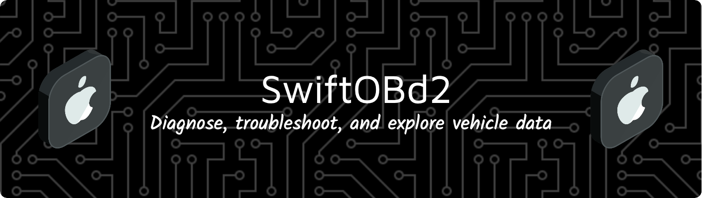

[](https://github.com/kkonteh97/SwiftOBD2/blob/main/LICENSE) [](http://makeapullrequest.com)    

[](https://github.com/kkonteh97/SwiftOBD2/stargazers) [](https://github.com/kkonteh97/SwiftOBD2/network/members)

## 🌟 Show Your Support

**⭐ Star this repo** if you find SwiftOBD2 useful! Your support helps the project grow and reach more developers.

[](https://github.com/kkonteh97/SwiftOBD2/graphs/contributors) [](https://github.com/kkonteh97/SwiftOBD2/issues) [](https://github.com/kkonteh97/SwiftOBD2/commits/main)

------------


SwiftOBD2 is a Swift package designed to simplify communication with vehicles using an ELM327 OBD2 adapter. It provides a straightforward and powerful interface for interacting with your vehicle's onboard diagnostics system, allowing you to retrieve real-time data and perform diagnostics. [Sample App](https://github.com/kkonteh97/SwiftOBD2App).

## 🚗 See It In Action

> **Demo coming soon!** We're preparing a comprehensive demo video showcasing real-time vehicle data retrieval, DTC scanning, and more.

### Screenshots
- Real-time RPM, Speed, and Engine Load monitoring
- Diagnostic Trouble Code (DTC) scanning and clearing
- Live sensor data visualization
- Bluetooth connection management

*Screenshots and demo GIF will be added in the next release*

## ⚡ Quick Start

Get up and running in 2 minutes:

```swift
// 1. Add to your project via Swift Package Manager
// File > Add Packages... > https://github.com/kkonteh97/SwiftOBD2

// 2. Import and connect
import SwiftOBD2

let obdService = OBDService(connectionType: .bluetooth)   // or .wifi, or .demo
let obd2Info = try await obdService.startConnection()

// 3. Get real-time data
for try await measurements in obdService.liveData([.mode1(.rpm), .mode1(.speed)]) {
    print("RPM: \(measurements[.mode1(.rpm)]?.value ?? 0)")
    print("Speed: \(measurements[.mode1(.speed)]?.value ?? 0)")
}
```

**Expected Output:**
```
RPM: 2150.0 
Speed: 65.0
```

Prefer Combine? `startContinuousUpdates(_:)` publishes the same dictionaries on the main queue.

### Requirements

- iOS 14.0+ / macOS 12.0+
- Xcode 14.0+
- Swift 5.7+

### Key Features

* Connection Management:
    * Connects to the OBD2 adapter via Bluetooth Low Energy or Wi-Fi, with a built-in simulated vehicle (demo mode).
    * Initialises the adapter, detects the vehicle protocol (preferred protocol, adapter search, then manual search) and identifies the ECUs.
    * Manages connection states (disconnected, connectedToAdapter, connectedToVehicle).

* Data Retrieval:
    * Real-time vehicle data (RPM, speed, temperatures, fuel trims…) with standard OBD2 PIDs.
    * Fast polling: up to six PIDs per request on CAN vehicles, with an automatic fallback for ECUs that do not support it.
    * Lists the PIDs, monitors and information types the vehicle supports.
    * Metric or imperial units.

* Diagnostics:
    * Stored, pending and permanent trouble codes (services 03, 07 and 0A), grouped by ECU, with descriptions.
    * Clears trouble codes (service 04).
    * Status since the codes were cleared: MIL, readiness of every monitor, distance / time / warm-up counters.
    * Freeze frame data (service 02).
    * On-board monitor test results with their limits (service 06) and on-board test requests (service 08).
    * Vehicle information (service 09): VIN, calibration IDs…

* Manufacturer specific data:
    * Custom PIDs defined by a request and a formula (`"(A*256+B)/4"`), on any ECU.
    * Import of community PID lists in the Torque CSV format.
    * Raw requests to any module (UDS / KWP2000), UDS trouble codes (service 19) for non-emission ECUs.

* Data logging:
    * Records any mix of standard and custom PIDs, in memory and/or straight to a CSV file. CSV and JSON export.

### Roadmap

- [x] Connect to an OBD2 adapter via Bluetooth Low Energy (BLE) 
- [x] Retrieve error codes (DTCs) stored in the vehicle's OBD2 system
- [x] Retrieve various OBD2 Parameter IDs (PIDs) for monitoring vehicle parameters
- [x] Retrieve real-time vehicle data (RPM, speed, etc.) using standard OBD2 PIDs
- [x] Get supported PIDs from the vehicle
- [x] Clear error codes (DTCs) stored in the vehicle's OBD2 system
- [x] Run tests on the OBD2 system
- [x] Retrieve vehicle status since DTCs cleared
- [x] Connect to an OBD2 adapter via WIFI
- [x] Add support for custom PIDs
- [x] Pending and permanent DTCs, freeze frames
- [x] Manufacturer specific requests (UDS / KWP2000) and per-ECU addressing
- [x] Data logging (CSV / JSON)

### Supported protocols

Every protocol an ELM327 can speak is handled, with 11 and 29 bit CAN identifiers detected automatically:

| ELM | Protocol | Status |
|-----|----------|--------|
| 1, 2 | SAE J1850 PWM / VPW | ✅ |
| 3 | ISO 9141-2 | ✅ |
| 4, 5 | ISO 14230-4 KWP2000 (5 baud / fast init) | ✅ |
| 6 – 9 | ISO 15765-4 CAN (11/29 bit, 250/500 kbit/s) | ✅ |
| B, C | User defined CAN | ✅ (OBD services and raw requests) |
| A | SAE J1939 | raw requests only |

> **What about OBD-I ("OBD 0 / OBD 1")?** Vehicles built before OBD-II use manufacturer specific connectors and
> protocols (GM ALDL, Ford EEC-IV, Honda blink codes, VAG KW1281…) that the ELM327 chip cannot speak electrically,
> so no ELM327 based library can read them. What *is* possible is talking to early or non-emission modules that
> use ISO 9141 / KWP2000 or CAN with their own addressing: see [Manufacturer specific data](#manufacturer-specific-data).

### Setting Up a Project

1. Create a New Swift Project:
    * Open Xcode and start a new iOS project (You can use a simple "App" template).

2. Add the SwiftOBD2 Package:
    * In Xcode, navigate to File > Add Packages...
    * Enter this repository's URL: https://github.com/kkonteh97/SwiftOBD2/
    * Select the desired dependency rule (version, branch, or commit).

3. Permissions and Capabilities:
    * Bluetooth:
        * Add NSBluetoothAlwaysUsageDescription to your Info.plist file with a brief description of why your app needs to use Bluetooth.
        * Navigate to the Signing & Capabilities tab in your project settings and add the Background Modes capability. Enable the Uses Bluetooth LE Accessories option.
    * Wi-Fi:
        * Add NSLocalNetworkUsageDescription to your Info.plist file: the adapter is reached on the local network.

### Key Concepts

* SwiftUI & Combine: `OBDService` is an `ObservableObject`; data is available as a Combine publisher or as an `AsyncThrowingStream`.
* OBDService: This is the core class within the SwiftOBD2 package. It handles communication with the OBD-II adapter and processes data from the vehicle.
* OBDCommand: These represent specific requests you can make to the vehicle's ECUs. `.custom(CustomCommand)` covers everything that is not in the built-in catalog.
* OBDConfiguration: Adapter settings (Wi-Fi address, time-outs, polling optimisations).

### Usage

#### Connecting

```swift
// Bluetooth LE: the first compatible adapter found is used
let obdService = OBDService(connectionType: .bluetooth)

// Wi-Fi: join the adapter's network first. Most adapters listen on 192.168.0.10:35000
let obdService = OBDService(connectionType: .wifi)
let obdService = OBDService(wifiHost: "192.168.4.1", wifiPort: 35000)

// Demo: a simulated vehicle, no hardware needed (also used by the simulator for Bluetooth)
let obdService = OBDService(connectionType: .demo)

let info = try await obdService.startConnection(preferedProtocol: .protocol6)   // the protocol is optional
print(info.vin ?? "?", info.obdProtocol?.description ?? "?", info.supportedPIDs ?? [])

obdService.stopConnection()
```

`connectionState` is `@Published`; `startConnection` throws `OBDServiceError.adapterConnectionFailed` with the
underlying reason (`ELM327Error.unableToConnect` when the ignition is off, `CommunicationError.timeout`…).

#### Reading data

```swift
// One round
let values = try await obdService.requestPIDs([.mode1(.rpm), .mode1(.coolantTemp)], unit: .metric)

// Continuously, with async/await…
for try await values in obdService.liveData([.mode1(.rpm), .mode1(.speed)], interval: 0.2) { … }

// …or with Combine (delivered on the main queue, polling stops when the subscription is cancelled)
obdService.startContinuousUpdates([.mode1(.rpm)])
    .sink(receiveCompletion: { print($0) }, receiveValue: { self.measurements = $0 })
    .store(in: &cancellables)
obdService.addPID(.mode1(.speed))        // add or remove PIDs while it runs

// Anything that is not a number: fuel type, VIN, monitor results…
let fuelType = try await obdService.sendCommand(.mode1(.fuelType)).get().stringResult
```

PIDs the vehicle does not support are simply absent from the result. Need more speed? See `OBDConfiguration.stopsAfterFirstResponse`.

#### Diagnostics

```swift
// Trouble codes, by ECU
let stored = try await obdService.scanForTroubleCodes()              // confirmed codes
let pending = try await obdService.scanForTroubleCodes(.pending)     // not confirmed yet
let all = try await obdService.scanForAllTroubleCodes()              // stored + pending + permanent
try await obdService.clearTroubleCodes()

// Status since the codes were cleared
let report = try await obdService.getStatusSinceDTCCleared()
print(report.status.MIL, report.status.dtcCount, report.status.isReadyForInspection)
print(report.status.incompleteMonitors.map(\.title), report.distanceSinceCleared?.value ?? 0)

// Conditions recorded when the fault occurred
if let freezeFrame = try await obdService.getFreezeFrame() {
    print(freezeFrame.troubleCode.code, freezeFrame.values[.mode1(.rpm)]?.value ?? 0)
}

// Results of the tests the vehicle runs on itself (CAN vehicles)
for monitor in try await obdService.getMonitorTestResults() {
    print(monitor.name ?? "", monitor.passed ? "passed" : "FAILED")
}

// Ask the vehicle to run an on-board test (0x01: evaporative system leak test)
try await obdService.requestOnBoardTest(0x01)
```

#### Manufacturer specific data

Standard OBD-II only covers emission related data. Everything else (gearbox temperature, boost, DPF load, ABS codes…)
is manufacturer specific, but nearly always follows the same pattern: a request sent to one ECU, and a formula
applied to the answer. That is exactly what a `CustomCommand` describes:

```swift
let oilTemperature = OBDCommand.custom(CustomCommand(
    name: "Oil temperature",
    request: "221154",          // service + identifier, here UDS ReadDataByIdentifier 0x1154
    formula: "A-40",            // A is the first data byte of the answer, B the second…
    unit: "°C",
    header: "7E0"               // the ECU to ask; omit to broadcast like a standard PID
))

// Custom commands work everywhere standard ones do: polling, streams, data logging…
let values = try await obdService.requestPIDs([oilTemperature, .mode1(.rpm)])
```

> The identifiers above are examples: PIDs differ between manufacturers, models and even model years.

Formulas support `+ - * / % ^`, bit operators (`& | << >>`), single bits (`{A:3}`) and the functions `SIGNED`,
`SIGNED16`, `INT16(A,B)`, `UINT16(A,B)`, `BIT`, `ABS`, `MIN`, `MAX`. Community PID lists in the Torque CSV format
can be imported as they are:

```swift
let commands = CustomCommand.parseCSV(try String(contentsOf: csvURL, encoding: .utf8)).map(OBDCommand.custom)
```

For modules that need more than a header (answers on an unusual address, extended addressing, wake-up messages…),
describe them with an `ECUTarget`, and use raw requests for anything a formula cannot express:

```swift
let abs = ECUTarget(header: "760", receiveAddress: "768")
let answers = try await obdService.request("22F190", to: abs)       // [Message], payload starts with 62 F1 90
let codes = try await obdService.scanForTroubleCodes(on: abs)       // UDS service 19
let lines = try await obdService.sendCommandInternal("ATRV", retries: 1)   // raw adapter access
```

#### Data logging

```swift
let logger = OBDDataLogger(service: obdService)
try logger.start([.mode1(.rpm), .mode1(.speed), oilTemperature], interval: 0.2, fileURL: csvURL)
// … drive …
logger.stop()

let csv = logger.csv()          // timestamp,elapsed_s,RPM (rpm),Vehicle Speed (km/h),Oil temperature (°C)
let json = try logger.json()
```

When a file is given each sample is appended as it arrives, so nothing is lost if the app is terminated.
`isRecording` and `sampleCount` are `@Published`.

### Code Example
```Swift
class ViewModel: ObservableObject {
    @Published var measurements: [OBDCommand: MeasurementResult] = [:]
    @Published var connectionState: ConnectionState = .disconnected
    @Published var requestingPIDs: [OBDCommand] = [.mode1(.rpm)]

    let obdService = OBDService(connectionType: .bluetooth)
    var cancellables = Set<AnyCancellable>()
    var updates: AnyCancellable?

    init() {
        obdService.$connectionState
            .assign(to: &$connectionState)
    }

    func startContinousUpdates() {
        updates = obdService.startContinuousUpdates(requestingPIDs)
            .sink { completion in
                print(completion)
            } receiveValue: { [weak self] measurements in
                self?.measurements = measurements
            }
    }

    func addPID(command: OBDCommand) {
        requestingPIDs.append(command)
        obdService.addPID(command)
    }

    func stopContinuousUpdates() {
        updates = nil
    }

    func startConnection() async throws  {
        let obd2info = try await obdService.startConnection(preferedProtocol: .protocol6)
        print(obd2info)
    }

    func stopConnection() {
        obdService.stopConnection()
    }

    func switchConnectionType() {
        obdService.connectionType = .wifi
    }

    func getStatus() async {
        let status = try? await obdService.getStatusSinceDTCCleared()
        print(status ?? "nil")
    }

    func getTroubleCodes() async {
        let troubleCodes = try? await obdService.scanForTroubleCodes()
        print(troubleCodes ?? "nil")
    }
}

struct ContentView: View {
    @ObservedObject var viewModel = ViewModel()
    var body: some View {
        VStack(spacing: 20) {
            Text("Connection State: \(viewModel.connectionState.description)")
            ForEach(viewModel.requestingPIDs, id: \.self) { pid in
                Text("\(pid.properties.description): \(viewModel.measurements[pid]?.value ?? 0) \(viewModel.measurements[pid]?.unit.symbol ?? "")")
            }
            Button("Connect") {
                Task {
                    do {
                        try await viewModel.startConnection()
                        viewModel.startContinousUpdates()
                    } catch {
                        print(error)
                    }
                }
            }
            .buttonStyle(.bordered)

            Button("Stop") {
                viewModel.stopContinuousUpdates()
            }
            .buttonStyle(.bordered)

            Button("Add PID") {
                viewModel.addPID(command: .mode1(.speed))
            }
        }
        .padding()
    }
}

```

### Supported OBD2 Commands

`OBDCommand.allCommands` lists the built-in catalog: service 01 PIDs `00`–`5F` plus torque and odometer,
the service 06 monitors and the service 09 information types. After connecting, `OBDInfo.supportedPIDs`
tells which of them the vehicle implements.

## 🛠️ Troubleshooting

### Common Issues

**Q: Bluetooth connection fails**
- Ensure Bluetooth permissions are granted in iOS Settings
- Verify your ELM327 adapter is in pairing mode
- Try restarting Bluetooth on your device

**Q: Wi-Fi connection fails**
- Join the adapter's Wi-Fi network in iOS Settings before connecting (it has no internet access, this is expected)
- Allow the "Local Network" permission for your app
- Check the address of your adapter: most use `192.168.0.10:35000`, some `192.168.4.1` or another port

**Q: No data received from vehicle**
- Check that your vehicle is OBD2 compatible (1996+ in US, 2001+ petrol / 2004+ diesel in Europe)
- Ensure the ELM327 adapter is properly connected to the OBD2 port
- Verify the vehicle is running (some data requires engine on)

**Q: App crashes on connection**
- Update to the latest version of SwiftOBD2
- Check that you've added required Bluetooth permissions to Info.plist

### Hardware Compatibility

✅ **Tested ELM327 Adapters:**
- BAFX Products Bluetooth OBD2
- OBDLink MX+ Bluetooth
- VEEPEAK Mini WiFi OBD2

⚠️ **Known Issues:**
- Some cheap ELM327 clones may have connectivity issues
- WiFi adapters require the phone to join their network first

### Getting Help

- 📋 [Open an issue](https://github.com/kkonteh97/SwiftOBD2/issues) for bug reports
- 💡 [Start a discussion](https://github.com/kkonteh97/SwiftOBD2/discussions) for questions
- 📱 Check out the [sample app](https://github.com/kkonteh97/SwiftOBD2App) for implementation examples

### Important Considerations

* Ensure you have a compatible ELM327 OBD2 adapter.
* Permissions: If using Bluetooth, your app may need to request Bluetooth permissions from the user.
* Error Handling:  Implement robust error handling mechanisms to gracefully handle potential communication issues.
* Background Updates (Optional): If your app needs background OBD2 data updates, explore iOS background fetch capabilities and fine-tune your library and app to work effectively in the background.


## Contributing

This project welcomes your contributions! Feel free to open issues for bug reports or feature requests. To contribute code:

1. Fork the repository.
2. Create your feature branch.
3. Commit your changes with descriptive messages.
4. Submit a pull request for review.

## License

The Swift OBD package is distributed under the MIT license. See the [LICENSE](https://github.com/kkonteh97/SwiftOBD2/blob/main/LICENSE) file for more details.

---

## 💖 Support the Project

Love SwiftOBD2? Here's how you can help:

- ⭐ **Star this repository** - It really makes a difference!
- 🐛 **Report bugs** - Help us improve by reporting issues
- 💡 **Suggest features** - Share your ideas for new functionality  
- 🔀 **Contribute code** - Submit PRs for fixes and enhancements
- 📢 **Spread the word** - Share with other iOS/Swift developers

**Current Stars: 106+ and growing! 🚀**

[](https://star-history.com/#kkonteh97/SwiftOBD2&Date)

### Related Projects

- [SwiftOBD2App](https://github.com/kkonteh97/SwiftOBD2App) - Sample iOS app demonstrating SwiftOBD2
- Want your project listed here? Open a PR!
